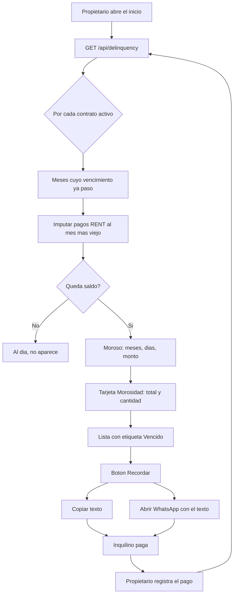
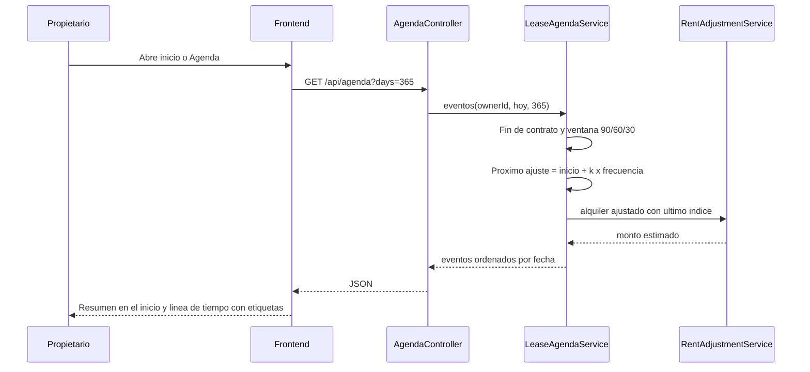
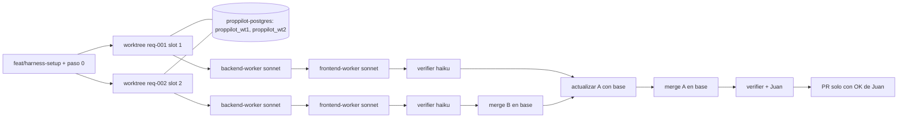
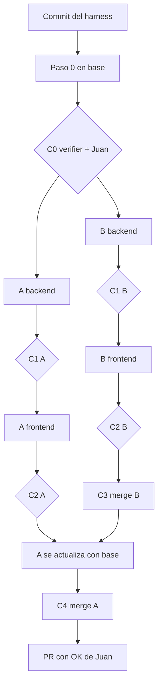

# Plan: REQ-001 morosidad y REQ-002 alertas de contrato

Estado: borrador, pendiente de validacion de Juan. Fecha: 2026-10-20. Base: rama `feat/harness-setup`.

## Indice
1. [Resumen](#1-resumen)
2. [Decisiones para Juan](#2-decisiones-para-juan)
3. [REQ-001: morosidad y recordatorios](#3-req-001-morosidad-y-recordatorios)
4. [REQ-002: alertas de vencimiento y proximo ajuste](#4-req-002-alertas-de-vencimiento-y-proximo-ajuste)
5. [Cruces entre las dos ramas](#5-cruces-entre-las-dos-ramas)
6. [Ejecucion en paralelo](#6-ejecucion-en-paralelo)
7. [Riesgos](#7-riesgos)
8. [Tamano por paso](#8-tamano-por-paso)
9. [Diagramas](#9-diagramas)
10. [Referencias de codigo](#10-referencias-de-codigo)

## 1. Resumen

**REQ-001, morosidad (v1).** El inicio muestra una tarjeta "Morosidad" con el total adeudado y cuantos inquilinos estan atrasados. Al tocarla se ve la lista: inquilino, propiedad, meses y dias de atraso, monto adeudado, y una etiqueta roja "Vencido". Cada fila tiene un boton "Recordar" que arma un mensaje listo para copiar o abrir en WhatsApp. Nada se envia solo. La deuda se calcula al vuelo a partir del contrato y de los pagos de alquiler; no se guarda un estado nuevo.

**REQ-002, alertas de contrato (v1).** Una pantalla nueva "Agenda" lista, por contrato, la fecha de fin y la fecha del proximo ajuste por indice (ICL o IPC), con el monto estimado. Los contratos que vencen en 90, 60 o 30 dias llevan una etiqueta de color, y los que ya vencieron sin renovar aparecen arriba en rojo. El inicio muestra un resumen de la agenda en lugar de la tarjeta violeta actual de "contratos por vencer". Todo dentro de la app, sin email.

Hallazgos que cambian el plan:
- El inicio ya tiene un aviso de "contratos por vencer en 60 dias" y otro de "proximo pago" basado en pagos `PENDING`. Los dos se calculan en el navegador. Las dos features tocan ese mismo bloque.
- Un pago no puede tener fecha futura (`@PastOrPresent`), asi que un pago "esperado" no existe como fila. La morosidad tiene que salir del calendario del contrato, no de la tabla de pagos.
- El contrato no tiene dia de vencimiento mensual. El requisito lo da por supuesto.
- Con los datos de ejemplo de hoy, todos los contratos activos pagaron hasta septiembre y ninguno octubre: con cualquier regla todos salen morosos. Ninguno vence en los proximos 90 dias. Hay que ajustar el seed para que la demo muestre casos variados.

## 2. Decisiones para Juan

Cada una con mi recomendacion en negrita.

| # | Decision | Opcion A | Opcion B | Recomiendo |
|---|---|---|---|---|
| D1 | Dia de vencimiento del alquiler | Campo nuevo `paymentDueDay` en el contrato (1 a 28, por defecto 10) | Regla fija: dia 10 de cada mes para todos | **A**. El requisito supone un dia por contrato; costo extra chico (un campo y un input en el formulario). |
| D2 | Dias de gracia antes de "Vencido" | Fijo en 0: vencido desde el dia siguiente al vencimiento | Constante global de 5 dias, configurable mas adelante | **A**. Con dia 10 por defecto ya hay margen de costumbre ("del 1 al 10"). Simple de explicar. |
| D3 | Monto adeudado: base o ajustado | Alquiler base del contrato | Alquiler ajustado por indice | **A** en v1. Los pagos de hoy se cargan por el monto base y el ajuste es continuo (brecha abierta); con el ajustado todos parecerian deber. Se muestra la leyenda "sobre alquiler base". |
| D4 | Pagos parciales | Se imputan al mes mas viejo (FIFO); el mes queda "parcial" con el saldo | Un mes cuenta como pagado con cualquier pago | **A**. Sale gratis del calculo por saldo y responde la pregunta abierta. |
| D5 | Canal del recordatorio | Texto para copiar | Texto para copiar mas enlace `wa.me` que abre WhatsApp con el texto | **B**. Sigue sin envio automatico (fuera de alcance), y el inquilino ya tiene telefono. |
| D6 | Canal de las alertas de contrato | Solo dentro de la app | App mas email | **A**. Email necesita proveedor, plantillas y un job; queda para despues. |
| D7 | Ventanas de aviso | 90/60/30 dias para fin de contrato; 30 dias para ajuste | 60/30/7 para ambos | **A**. Es lo que pide REQ-002; renovar necesita tiempo. |
| D8 | Proximo ajuste y la brecha de ajuste escalonado | Fecha = inicio + k x frecuencia (usa `adjustmentFrequencyMonths`); monto estimado = alquiler ajustado con el ultimo indice (el calculo actual). No se toca el calculo existente. | Ademas arreglar el ajuste escalonado (el alquiler cambia solo cada N meses) | **A**. El estimado de A es justamente lo que daria el ajuste escalonado con el ultimo indice publicado, asi que es coherente. Arreglar el calculo cambia la tarjeta "ajustado a hoy" y el smoke test; va en un ticket propio. |
| D9 | Donde se ven las alertas | Morosidad: tarjeta en el inicio + lista en un dialogo. Agenda: pantalla nueva + resumen en el inicio | Todo en el inicio, sin pantalla nueva | **A**. La agenda es una linea de tiempo y no entra en una tarjeta. La morosidad cabe en un dialogo y no agrega navegacion. |
| D10 | Contrato vencido con inquilino adentro | Se lista como "Vencido sin renovar" (estado `ACTIVE` con fin pasado) en rojo arriba en la Agenda | Se ignora | **A**. Hoy nada pasa a `EXPIRED` solo, asi que estos casos existen. No se agrega job de expiracion en v1. |

## 3. REQ-001: morosidad y recordatorios

### Flujo de usuario
1. El propietario entra al inicio. Ve la tarjeta "Morosidad": "$ 1.230.000 adeudado, 3 inquilinos".
2. Toca la tarjeta. Se abre la lista ordenada por dias de atraso.
3. Toca "Recordar" en una fila. Se abre un dialogo con el texto: saludo, propiedad, meses adeudados, monto. Botones "Copiar" y "Abrir en WhatsApp".
4. Cuando el inquilino paga, el propietario registra el pago como hoy. La deuda se recalcula y la fila desaparece o baja.
5. En la lista de pagos, un aviso rojo "N contratos con pagos vencidos" lleva a la misma lista.

### Dominio y datos
- Concepto nuevo, calculado y no guardado: **deuda por contrato**. Para cada contrato activo, cada mes desde el inicio cuyo vencimiento (dia D1, mas gracia D2) ya paso genera un alquiler esperado. Solo cuentan los pagos `RENT` con estado `PAID`; se imputan al mes mas viejo. Un pago `PENDING` no cubre nada. Lo que queda sin cubrir es deuda. Un contrato `ACTIVE` con fin pasado (D10) entra, con los meses cortados en `endDate`.
- Resultado por contrato: meses adeudados (enteros y parcial), monto adeudado, fecha del mes impago mas viejo, dias de atraso desde esa fecha.
- Campo nuevo en `Lease`: `paymentDueDay` (si D1 = A). Columna nullable; el codigo usa 10 si es nulo, asi no hace falta migracion de datos.
- No se agrega `OVERDUE` a `Payment.status`. "Vencido" es una etiqueta de la vista, no un estado guardado.
- El calculo de saldo pendiente actual queda como esta; el nuevo servicio no lo reutiliza porque no sabe de dias de vencimiento. Ojo: ese calculo suma pagos de cualquier estado (`PaymentRepository.java:102-103`), incluso `PENDING`. No se toca en v1; ticket aparte.

### Backend
- Servicio nuevo `DelinquencyService` (interfaz + impl) con un metodo que recibe `ownerId` y `asOf` (fecha, para tests deterministas).
- Controlador nuevo `DelinquencyController`: `GET /api/delinquency` (lista y totales). Archivo propio para no tocar `PaymentController` ni `LeaseController`.
- DTO record para la respuesta (como `AdjustedRentResponse`).
- `Lease.java`: campo `paymentDueDay` con validacion 1 a 28.
- `LeaseServiceImpl.java`: el update copia campo por campo (`:199-225`); agregar `paymentDueDay` en update y revisar el alta (`~:110-123`).
- Pagos leidos solo para contratos ya cargados por owner, con `findByLeaseIdAndStatusAndOwnerId(leaseId, PAID, ownerId)`. Nunca `findByLeaseId`.
- Mensajes de error en espanol.

### Frontend
- Componente nuevo `DelinquencyCard.jsx` (tarjeta del inicio) y `DelinquencyDialog.jsx` (lista + dialogo de recordatorio).
- `DashboardView.jsx`: una linea que monta la tarjeta en su slot, mas su import en su ancla. No se toca el aviso naranja "proximo pago"; que hacer con el se decide despues del merge.
- `PaymentForm.jsx`: aviso rojo arriba de la lista cuando hay morosos. Primer recorte si falta tiempo.
- `LeaseForm.jsx`: input "Dia de vencimiento" en alta y edicion.
- Texto del recordatorio armado en el frontend con `t()`, con el nombre del inquilino, la direccion y el monto.

### Owner scoping
- El servicio carga contratos y pagos solo con `ownerId` de `CurrentUserService`. Ningun id llega en el body.
- Test que prueba que el propietario B no ve la deuda del propietario A.

### i18n
- Claves nuevas en `es` y `en` dentro del bloque `// REQ-001` reservado en el paso 0: titulo de la tarjeta, columnas, "Recordar", "Copiar", "Abrir en WhatsApp", plantilla del mensaje, leyenda "sobre alquiler base".

### Tests
- Primero, unitario que falla: `DelinquencyServiceImplTest` (JUnit + Mockito, fecha fija). Casos: al dia, dentro del dia de vencimiento, un mes impago, dos meses impagos, pago parcial, pago `PENDING` no cubre el mes, contrato `ACTIVE` con fin pasado cortado en `endDate`, contrato terminado excluido, contrato que empieza a mitad de mes, filtro por owner con `verifyNoMoreInteractions` sobre los repos.
- Update de un contrato con `paymentDueDay = 15` y releer 15.
- Validacion de `paymentDueDay` fuera de rango.
- E2E: `proppilot-frontend/e2e/req-001-morosidad.spec.js`. Primero afirma que la API devuelve `tenantCount >= 1` (si no, falla, no pasa vacio). Despues la tarjeta muestra el total y la cantidad de la API, y el dialogo lista un inquilino del seed con 2 meses impagos (moroso en cualquier dia del mes). "Recordar" muestra un texto con el nombre del inquilino.

### Definicion de hecho
1. El test unitario falla sin el servicio y pasa con el.
2. `scripts/wt.sh verify req-001 --e2e` termina en `verify: OK`.
3. El verifier recorre el flujo en la UI del slot y adjunta captura.
4. Pagina wiki `concepts/delinquency.md`, `payment` y `lease` actualizadas, entrada en `log.md`.

## 4. REQ-002: alertas de vencimiento y proximo ajuste

### Flujo de usuario
1. En el inicio, el resumen "Agenda" dice: "2 contratos vencen en menos de 90 dias, 1 ajuste este mes". Reemplaza la tarjeta violeta actual.
2. Toca el resumen o el item nuevo "Agenda" del menu. Ve una lista agrupada por mes de los proximos 12 meses. Si falta tiempo, lista plana por fecha (segundo recorte).
3. Cada fila: direccion, inquilino, tipo de evento (fin de contrato o ajuste), fecha, etiqueta de color (rojo vencido sin renovar, naranja 30 dias, amarillo 60, gris 90) y, para ajustes, monto base y monto estimado.
4. Toca una fila y va al contrato (navegacion existente a la vista de contratos).

### Dominio y datos
- Concepto nuevo, calculado: **evento de contrato**, con tipo (`END`, `ADJUSTMENT`), fecha, dias que faltan y nivel de alerta.
- Fecha del proximo ajuste: primera fecha `inicio + k x adjustmentFrequencyMonths` posterior a hoy y anterior al fin. Contratos con indice `NONE` o `DOLAR_*` no tienen evento de ajuste.
- Monto estimado: el calculo actual de alquiler ajustado con el ultimo indice (D8). Si no hay indice, solo fecha.
- Sin cambios de esquema.

### Backend
- Servicio nuevo `LeaseAgendaService` (interfaz + impl), metodo con `ownerId`, `asOf` y horizonte en dias. Usa `RentAdjustmentService` sin modificarlo.
- Controlador nuevo `AgendaController`: `GET /api/agenda?days=365`. Archivo propio.
- DTO record para el evento.

### Frontend
- Vista nueva `AgendaView.jsx`, montada como vista 5 en `App.jsx` y en el menu (escritorio y `MobileBottomNav`).
- Componente `AgendaSummaryCard.jsx` para el inicio, en el lugar reservado en el paso 0. Se quita el calculo de "contratos por vencer" del navegador en `DashboardView`.
- No se toca `LeaseForm.jsx` en v1 (ese archivo es de la rama REQ-001). Mostrar el proximo ajuste dentro del detalle del contrato queda como seguimiento despues del merge.

### Owner scoping
- Contratos leidos por `ownerId`. El calculo de ajuste ya filtra por owner. Test de aislamiento igual que en REQ-001.

### i18n
- Claves en `es` y `en` dentro del bloque `// REQ-002`: "Agenda", tipos de evento, etiquetas de ventana, "Vencido sin renovar", "monto estimado con el ultimo indice".

### Tests
- Primero, unitario que falla: `LeaseAgendaServiceImplTest`. Casos: frecuencia 12, 6 y 3; inicio el dia 15; ajuste que cae despues del fin (no se muestra); indice `NONE`; ventanas 90/60/30 en sus bordes; contrato `ACTIVE` con fin pasado; contrato terminado excluido; filtro por owner.
- E2E: `proppilot-frontend/e2e/req-002-agenda.spec.js`. Primero afirma en la API un evento `ADJUSTMENT` para Av. Santa Fe 2450 y `expiredNotRenewed >= 1`. Despues la Agenda muestra esa fecha de ajuste y la fila roja del vencido sin renovar; el resumen del inicio coincide con la API.

### Definicion de hecho
Igual que REQ-001, con la pagina wiki `concepts/lease-agenda.md`, `rent-adjustment` y `lease-lifecycle` actualizadas.

## 5. Cruces entre las dos ramas

| Archivo | REQ-001 | REQ-002 | Como se evita el choque |
|---|---|---|---|
| `LanguageContext.jsx` | claves nuevas | claves nuevas | Paso 0 agrega bloques vacios `// REQ-001` y `// REQ-002` en `es` y en `en`, separados. Cada rama escribe solo en el suyo. |
| `DashboardView.jsx` | tarjeta morosidad | resumen agenda, quita la tarjeta violeta | Paso 0 separa los dos slots (`:338-339`) con una linea en blanco y un ancla fija entre ellos, y agrega un ancla de import por carril. Solo REQ-002 toca el bloque de avisos (`:341-403`); REQ-001 no toca el aviso naranja. Cada rama crea su componente en archivo propio. |
| `scripts/seed.py`, `e2e/smoke.spec.js` | necesita morosos variados (uno con 2 meses impagos) | contratos que vencen pronto y uno `ACTIVE` con fin pasado (D10) | Paso 0 hace los cambios de datos antes de abrir las ramas. El vencido sin renovar rompe el smoke (`smoke.spec.js:16` compara con `/leases/active`, que filtra por fecha en `LeaseRepository.java:75-76`); el Paso 0 cambia esa linea para comparar con `/leases` filtrado por `status === 'ACTIVE'`, como hace `DashboardView.jsx:78`. |
| `scripts/verify.sh` y `e2e/smoke.spec.js` | e2e nuevo | e2e nuevo | Paso 0 hace que verify corra `smoke.spec.js` mas `req-*.spec.js` y mueve `login` y `apiGet` a `e2e/helpers.js`. Cada rama crea su spec. |
| `App.jsx`, `MobileBottomNav.jsx` | no | vista nueva | Solo REQ-002. |
| `Lease.java`, `LeaseServiceImpl.java`, `LeaseForm.jsx` | `paymentDueDay` | no | Solo REQ-001. |
| `PaymentForm.jsx` | aviso rojo | no | Solo REQ-001. |
| `Payment.java` | no se toca | no se toca | Sin cruce. |
| `wiki/log.md`, `wiki/index.md` | entrada | entrada | Choque de texto trivial al final del archivo. Se resuelve a mano en el merge. |

**Orden de merge:** primero REQ-002 (no toca esquema ni archivos de pagos y es mas chico), despues REQ-001. Antes del segundo merge, la rama REQ-001 hace `git merge feat/harness-setup` en su worktree, corre verify otra vez y recien ahi se integra.

## 6. Ejecucion en paralelo

### Preparacion
- `feat/harness-setup` tiene cambios sin commit (`wt.sh`, `resource-watch.sh`, el skill `parallel-worktrees`, este plan y los requisitos). Un worktree nuevo sale del ultimo commit, asi que primero hay que commitear el harness. Lo decide Juan.
- Paso 0, en la rama base, un `frontend-worker` (sonnet): seed, bloques i18n, lugares en `DashboardView`, `e2e/helpers.js`, glob en `verify.sh`. Verifier (haiku) corre `scripts/verify.sh --e2e` en el stack principal. Juan mira el commit.

### Carriles
| Carril | Worktree y rama | Slot | Agentes |
|---|---|---|---|
| A, REQ-001 | `scripts/wt.sh new req-001 feat/harness-setup` -> `feat/req-001` | 1 (`:8081`, `:3001`, `proppilot_wt1`) | `backend-worker` (sonnet) luego `frontend-worker` (sonnet) |
| B, REQ-002 | `scripts/wt.sh new req-002 feat/harness-setup` -> `feat/req-002` | 2 (`:8082`, `:3002`, `proppilot_wt2`) | `backend-worker` (sonnet) luego `frontend-worker` (sonnet) |

Nota: los slots comparten el unico contenedor `proppilot-postgres`, con una base por slot. No se levanta un segundo contenedor (regla de `CLAUDE.md`).

### Checkpoints
1. **C0** despues del paso 0: verifier + Juan.
2. **C1** por carril, backend listo: test unitario en rojo y luego verde, `curl` del endpoint nuevo en el slot. Verifier.
3. **C2** por carril, frontend listo: `scripts/wt.sh verify <nombre> --e2e` y recorrido en la UI con captura. Verifier, despues Juan mira las capturas.
4. **C3** merge de B en `feat/harness-setup`, verify en el stack principal. Verifier.
5. **C4** merge de A (ya actualizado con B), verify en el stack principal, recorrido de los dos flujos. Verifier + Juan.
6. PR hacia `main` solo cuando Juan lo diga.

Para ahorrar memoria, el stack principal (slot 0) queda apagado mientras corren los dos carriles.

## 7. Riesgos

| Riesgo | Mitigacion |
|---|---|
| Memoria: 16 GB, swap casi lleno. Cada stack de slot usa unos 0,5 a 0,7 GB (backend + vite) y el build de Maven pica mas. | Maximo 2 stacks: los dos carriles, con el stack principal apagado. `scripts/resource-watch.sh` corriendo. `wt.sh up` ya se niega con menos de 15% libre. No correr `verify` en los dos carriles al mismo tiempo; el verifier los hace en serie. Si hay alerta CRIT, bajar el carril B primero. |
| Calculo de deuda con fechas (fin de mes, dia 31, febrero). | `paymentDueDay` maximo 28. Tests con fecha fija, nunca `LocalDate.now()` dentro del servicio. |
| Demo dependiente de la fecha de hoy. | El seed calcula fechas relativas a hoy; los e2e comparan UI contra API, no valores fijos. |
| El monto estimado difiere del oficial (indices sinteticos en dev). | Leyenda "estimado con el ultimo indice disponible" y fecha del indice. |
| Morosidad sobre alquiler base subestima la deuda real. | Leyenda visible. Ticket aparte para ajuste escalonado y saldo ajustado (brechas 1 y 2 de `open-questions`). |
| Choques de merge en `DashboardView` y `LanguageContext`. | Paso 0 y orden de merge (seccion 5). |
| Tests de controlador dependen de Postgres local. | Los tests nuevos de servicio son unitarios con Mockito; el de aislamiento por owner tambien: pagos solo por `findByLeaseIdAndStatusAndOwnerId` y `verifyNoMoreInteractions` sobre los repos. |
| Worker sonnet que toca archivos del otro carril. | El brief de cada worker lista los archivos permitidos (tabla de la seccion 5). El verifier revisa `git diff --stat` contra esa lista. |

## 8. Tamano por paso

| Paso | Tamano |
|---|---|
| Commit del harness pendiente | S |
| Paso 0: seed, i18n, lugares en el inicio, helpers e2e, glob de verify | S |
| A backend: servicio, endpoint, `paymentDueDay`, tests | M |
| A frontend: tarjeta, lista, recordatorio, aviso en pagos, input en contrato, e2e | M |
| B backend: servicio agenda, endpoint, tests | M |
| B frontend: vista Agenda, menu, resumen en el inicio, e2e | M |
| Merge B, verify | S |
| Merge A con actualizacion, verify, recorrido final | S |
| Wiki y log por carril | S |

## 9. Diagramas

### a. Flujo de morosidad

### b. Alertas de vencimiento y ajuste

### c. Worktrees en paralelo

### d. Orden de pasos

## 10. Referencias de codigo

- Pago sin fecha futura: `proppilot-backend/src/main/java/com/prop_pilot/entity/Payment.java:42` (`@PastOrPresent`).
- Estados de pago `PAID`/`PENDING`: `Payment.java:55`, enum en `:149`.
- Saldo pendiente con alquiler base: `proppilot-backend/src/main/java/com/prop_pilot/service/impl/PaymentServiceImpl.java:158-182`.
- Reglas de pago: `PaymentServiceImpl.java:43-63`.
- Endpoints de pagos: `proppilot-backend/src/main/java/com/prop_pilot/controller/PaymentController.java:22-150`.
- Campos del contrato, sin dia de vencimiento: `proppilot-backend/src/main/java/com/prop_pilot/entity/Lease.java:45-87`; `adjustmentFrequencyMonths` en `:68`; `isActive()` en `:150`.
- Calculo de ajuste continuo: `proppilot-backend/src/main/java/com/prop_pilot/service/impl/RentAdjustmentServiceImpl.java:40-80`.
- DTO de ejemplo (record): `proppilot-backend/src/main/java/com/prop_pilot/dto/AdjustedRentResponse.java`.
- `@EnableScheduling` ya activo, sin jobs: `proppilot-backend/src/main/java/com/prop_pilot/PropPilotApplication.java:12`.
- Inicio: calculo de "contratos por vencer" a 60 dias `proppilot-frontend/src/components/DashboardView.jsx:79-85` y `:111-123`; "proximo pago" por `PENDING` `:126-146`; bloque de avisos `:338-403`.
- Vistas por indice: `proppilot-frontend/src/App.jsx:498-594`.
- Chips de estado en pagos: `proppilot-frontend/src/components/PaymentForm.jsx:844-883`.
- Etiquetas "Vencido" sin estado en backend: `proppilot-frontend/src/contexts/LanguageContext.jsx:315`, `:392`.
- Seed: contratos `scripts/seed.py:41-48`; pagos hasta el mes anterior `scripts/seed.py:125-136`.
- verify corre solo el smoke: `scripts/verify.sh:72`.
- Slots y Postgres compartido: `scripts/wt.sh:1-25`, `wiki/pages/architecture/parallel-worktrees.md`.
