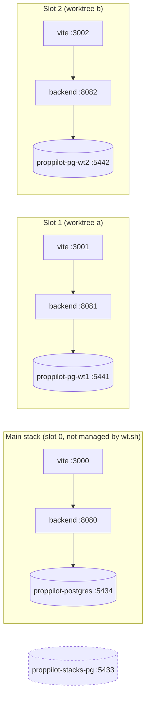

# Parallel worktrees

Extra stacks beside the main one, so parallel sessions test without sharing ports or data. Each stack is a git worktree with its own backend, frontend and Postgres container. Procedure for agents: the `parallel-worktrees` skill. Context: [[harness]], [[testing]], [[decisions]].

## Why

The first version used one shared Postgres with a database per slot. Juan rejected it. One container per slot gives real isolation: separate process, separate volume, separate port. `rm` then deletes the whole database by deleting the container and volume. (Rejection of v1 is from the coordinator brief and the log entry "container per slot"; the old code is not in the repo, so UNVERIFIED beyond that.)

## Layout



`proppilot-stacks-pg` on :5433 belongs to another project. Never touch it. It is running on this machine now (`docker ps`).

## Slots and ports

| Slot | Backend | Frontend | Postgres container | Host port |
|---|---|---|---|---|
| 0 (main) | 8080 | 3000 | `proppilot-postgres` | 5434 on this machine (`.dev.env`) |
| N (1..4) | 8080+N | 3000+N | `proppilot-pg-wtN`, volume `proppilot-pg-wtN-data` | 5440+N |

- Slot formula: `scripts/wt.sh:124`, `scripts/wt.sh:132-136`.
- `new` takes the lowest slot from 1 to `MAX_STACKS` that is not used and whose three ports are free (`scripts/wt.sh:123-126`).
- `wt.sh` never manages slot 0. `ls` only reports what listens on 8080 and 3000 (`scripts/wt.sh:232-237`).
- Gotcha: the default `POSTGRES_PORT` is 5433 (`scripts/lib/env.sh:11`, `.dev.env.example`). That is the other project's port. The main stack here works only because the gitignored `.dev.env` sets 5434. Keep it that way.
- Gotcha: the main stack's container name comes from the compose file (`proppilot-backend/docker-compose.yml:6`), and `PG_CONTAINER` defaults to `proppilot-postgres` (`scripts/lib/env.sh:16`).

## Commands

Usage text is copied from `scripts/wt.sh:5-11`.

```
scripts/wt.sh new <name> [base-ref]   worktree .claude/worktrees/<name>, branch feat/<name>, next free slot
scripts/wt.sh up <name> [--force]     Postgres container, backend (jar, small JVM) + vite in the background
scripts/wt.sh down <name>
scripts/wt.sh seed <name>             reset and seed only that slot's database
scripts/wt.sh verify <name> [--e2e]   scripts/verify.sh inside that worktree against its own stack
scripts/wt.sh ls                      slots, ports, state, RSS per stack
scripts/wt.sh rm <name> [--force]     down, delete its Postgres container and volume, remove the worktree (the branch stays)
```

What each one really does:

- `new`: name must match `^[a-z0-9][a-z0-9-]*$` (`:119`). Default base ref is `feat/harness-setup` (`:118`). Runs `git worktree add`, writes the worktree's `.dev.env` (SLOT, ports, `PG_CONTAINER`, `POSTGRES_PORT`, `MAX_STACKS`, `MIN_FREE_MEM_PCT`; `:129-139`), creates the container, installs frontend deps, waits for Postgres. Does not check memory.
- `up`: refuses if already up (`:166`). Without `--force` it refuses when running stacks >= `MAX_STACKS` or free memory < `MIN_FREE_MEM_PCT` (`:168-174`). Then starts the container, builds the jar with `mvn -q -DskipTests package`, starts the jar, waits up to 180 s on `/api/countries`, starts vite, waits up to 60 s (`:175-202`). Logs and pids: `<worktree>/.stack/`.
- `down`: stops vite and backend, removes pid files, `docker stop` on the slot container. Data stays in the volume (`:205-212`).
- `seed`: needs the backend up. Runs `seed.py --reset` against that slot's API and container (`:214-219`).
- `verify`: needs the backend up. Runs `scripts/verify.sh` in the worktree with the slot's env, `JAVA_TOOL_OPTIONS="-Xmx512m -XX:+UseSerialGC"` so Maven and surefire stay small (`:221-227`).
- `ls`: table of slot, name, ports, state, MB per backend, frontend and Postgres, then free memory and limits (`:229-247`).
- `rm`: refuses with uncommitted changes unless `--force`. Then `down`, `docker rm -f`, `docker volume rm`, `git worktree remove --force`. The branch `feat/<name>` stays (`:249-259`).

Typical flow: `new` then `up` then `seed`, work in `.claude/worktrees/<name>`, `verify <name> --e2e`, `rm`. UI at `http://localhost:300N`.

## Limits

- `MAX_STACKS=4`, `MIN_FREE_MEM_PCT=15`, `BACKEND_JAVA_OPTS` can be overridden in `.dev.env` (`scripts/wt.sh:12`, `:20-22`).
- Gotcha: `MAX_STACKS` counts worktree slots only. The main stack is not counted. With the main stack up, 4 slots mean 5 stacks on the machine. In `up`, the count is slots with a live backend pid (`:169-171`). `--force` skips the count and the memory check.
- JVM is capped: `-Xms64m -Xmx512m -XX:MaxMetaspaceSize=192m -Xss512k -XX:+UseSerialGC -XX:TieredStopAtLevel=1 -XX:+ExitOnOutOfMemoryError` (`:22`), Hikari pool 5 (`:187`). Vite runs with `--max-old-space-size=256` (`:196`).
- Slot Postgres: `postgres:15`, `--memory 256m`, `shared_buffers=32MB`, `max_connections=30`, `work_mem=2MB` (`:94-100`).
- Memory is read with `footprint`, not `ps`, because macOS compresses idle pages and `ps` RSS undercounts a JVM (`:59-65`).
- Machine: 16 GB. One stack is about 750 MB (about 212 MB backend, about 33 MB Postgres, 270-475 MB idle vite; vite reaches about 900 MB while verify builds and lints in the same tree). Recommended: 2 parallel stacks. The 750 MB total and the 16 GB figure come from the coordinator brief; the per-part numbers are from the earlier measurement logged in [[log]]. UNVERIFIED as a fresh measurement.

## Resource watch

`scripts/resource-watch.sh` samples the machine and prints one line per level change (OK, WARN, CRIT).

- Run under Monitor: `scripts/resource-watch.sh`. One sample: `--once`. Report: `--report` (`:110-122`).
- Each sample is a line in `~/.cache/proppilot-resource-watch/samples.csv` (`RW_STATE_DIR`, `:14`). Columns: `iso_ts,stacks,free_pct,swap_gb,load1,java_mb,node_mb,pg_containers,docker_mb,claude_count,claude_mb,level` (`:73`).
- Levels (`:60-68`): CRIT when free memory < 10% (`RW_CRIT_FREE`) or pressure level 4. WARN when free < 20% (`RW_WARN_FREE`), swap grew more than 1 GB (`RW_SWAP_GROWTH_GB`), or load1 > 1.5 x CPUs (`RW_LOAD_MULT`). `RW_PL_WARN=1` also makes pressure level 2 a WARN; off by default because it is always set on this Mac (`:5`). Interval 30 s (`RW_INTERVAL`).
- `--report` groups samples by stack count and prints min and median free memory and max load. It suggests the largest stack count whose minimum free memory stayed at or above the WARN threshold (`:89-108`).
- It counts stacks as listeners on 8080-8084 (`:49`), so the main stack counts here. That differs from `MAX_STACKS`.
- Note: `wt.sh up` blocks at 15% free, the watcher warns at 20% free. The warning comes first.

## Isolation evidence

From the independent verifier `wt-verifier` (coordinator brief; no transcript in the repo, so UNVERIFIED from files): 7 of 7 checks PASS.

- A row created in slot `vt-a` was not visible in slot `vt-b` or in the main stack.
- Two stacks ran `verify` in parallel and both passed.
- The `MAX_STACKS` refusal and the low-memory refusal both work.
- `rm` removed the container and the volume.
- The main stack stayed up. Free memory was 32% with 2 stacks.

Earlier run (logged in [[log]]): `wt-a` slot 1 and `wt-b` slot 2 verified at once with `--e2e`, lowest free memory 29%.

## Wiring

- `load_dev_env` reads the worktree's `.dev.env` and exports ports, `DB_NAME`, `PG_CONTAINER`, `DATABASE_URL`, `PORT` (`scripts/lib/env.sh:4-20`). `in_slot` unsets the caller's values first, so a slot never inherits the main stack's settings (`scripts/wt.sh:48-53`).
- Backend: `server.port` reads `PORT` (`application.yml:24`); datasource reads `DATABASE_URL` (`application.yml:4`).
- Frontend: `vite.config.js` reads `FRONTEND_PORT` and `BACKEND_PORT` with `strictPort`, so a busy port fails instead of moving to another slot's port.
- `node_modules` is cloned with `cp -cR` when the lockfile matches, else `npm ci --prefer-offline` (`scripts/wt.sh:149-159`).

## Gotchas and cleanup

- JDK: `up` calls `use_project_jdk` (`scripts/wt.sh:179`). It ignores a global `JAVA_HOME` and picks `PROPPILOT_JAVA_HOME`, then sdkman 17, sdkman 21, Homebrew openjdk@21 (`scripts/lib/java.sh:4-12`). Reason: JDK 25 breaks Lombok in Spring Boot 3.2 (`scripts/lib/java.sh:1-2`).
- A new worktree starts from a committed base. Uncommitted harness changes are missing there. The base must already contain `scripts/wt.sh`.
- Do not hand-edit SLOT, ports or container keys in a slot's `.dev.env` (`.dev.env.example`).
- `verify` does not wipe seed data, but re-run `seed` after schema changes (skill, "Rules"). UNVERIFIED in code here.
- `rm` leaves the branch. After it: `git branch -D feat/<name>` if merged or abandoned. Then check `scripts/wt.sh ls`, `docker ps -a` and `docker volume ls` for leftovers.
- If `new` fails after `git worktree add`, a half-made worktree can remain (`set -e`, no rollback in the script). `rm` needs the worktree's `.dev.env` with SLOT (`:42-45`), so if the failure came before that file was written, use `git worktree remove --force` by hand. UNVERIFIED by test.
